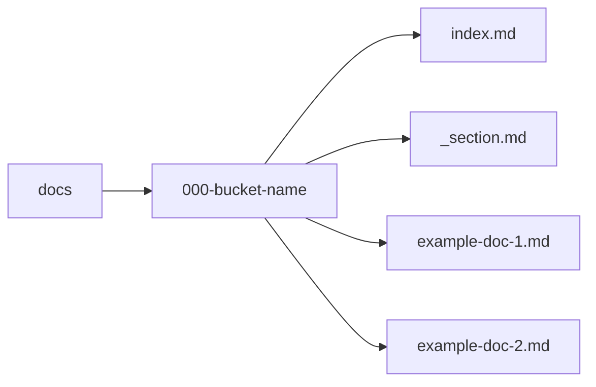

### Create new docs directories

> [!NOTE]
> Create new docs directories only when the content does not fit into an existing content bucket. If you are unsure, please ask in the AsyncAPI Community Slack #docs channel first.

1. Open the `asyncapi/community` repository locally in your code editor of choice and navigate to the `docs` folder.
1. Under the `docs` folder, create a new content bucket (folder) for your new content, respecting the following naming convention: `<numeric-prefix>-<content-bucket-name>`, where:
    - numeric-prefix is a 3-digit number that represents the order in which the content bucket should appear in the website's navigation. Consider adding new content buckets at the end of the navigation to avoid breaking existing links. If you need to insert a new content bucket in the middle of the navigation, use adjacent numbers and leave gaps for future additions. For example, to insert a new content bucket between `000-onboarding` and `010-contribution-guidelines`, you could name it `001-new-content-bucket`.
    - content-bucket-name is a descriptive name for the content bucket written in kebab-case (lowercase letters with hyphens separating words).
1. Only direct children of the `docs` folder are allowed as the current website's implementation doesn't support nested folders. All content must be organized within the first level of folders under `docs`.
1. Give an appropriate name to the new content bucket.
1. Add the following two files to the new content bucket:
    1. `index.md`: Used as the main content for a website's directory or specific webpage. It's named index because many web servers are configured to automatically look for an index file when accessing a directory. When you access a directory on a web server, if an `index.md` file is present, it will be displayed as the default page for that directory.
    1. `_section.md`: Contains section metadata. The `title` defines the section name in the website sidebar. The `weight` controls the section's order relative to other sections.
1. You can edit the index page after successfully creating these pages. 

